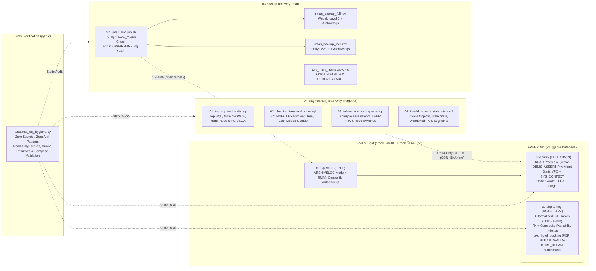

# Oracle 23ai Free — Enterprise DBA Security, OLTP Tuning & RMAN DR Lab

[](https://github.com/nthihongphuc/oracle-dba-security-tuning-lab/actions/workflows/ci.yml)


[](./LICENSE)

[Architecture](#architecture-overview) • [Quickstart](#quickstart-docker-compose--oracle-23ai-free) • [Diagnostics Kit](#day-2-diagnostics--incident-triage-kit-04-diagnostics) • [Verification](#sample-benchmark--verification-outputs) • [RMAN DR](#rman-backup--disaster-recovery-strategy) • [License](#license)

A clean-room, production-grade **Oracle Database 23ai Free** engineering lab demonstrating end-to-end Mid-to-Senior DBA ownership across four core pillars:

1. **Enterprise Database Security** — Multitenant PDB least-privilege RBAC (`RESOURCE_LIMIT=TRUE`), SQL-injection-proof dynamic privilege delegation (`DBMS_ASSERT` + safe `SCHEMA.OBJECT` splitting), Shared-Pool-friendly VPD/RLS (`DBMS_RLS.STATIC` + PDB `AFTER LOGON` Application Context), Unified Auditing + Fine-Grained Auditing (`DBMS_FGA`) with rolling UTC watermark & `DBMS_AUDIT_MGMT` purge automation, and modern 19c/23ai TDE Wallet architecture.
2. **OLTP Schema Normalization, Concurrency & SQL Tuning** — 3NF Hotel Booking OLTP schema (`hotel_app`), concurrency-safe multi-room PL/SQL API (`INSERT ... RETURNING INTO`, ascending `room_id` deadlock-free lock ordering, `SELECT ... FOR UPDATE WAIT 5` + `ORA-30006` handling), ~801k-row `ORA-30009`-safe cross-join synthetic data generator, and reproducible Before vs After `DBMS_XPLAN.DISPLAY_CURSOR` benchmarks.
3. **Backup & Disaster Recovery (RMAN)** — Automated Level 0 Full & Level 1 Incremental compressed (`BASIC`, license-free) backup scripts, concurrency-locked Bash wrapper with `ARCHIVELOG` pre-flight validation, and a complete PDB PITR & `RMAN RECOVER TABLE` DR runbook with RPO/RTO validation metrics.
4. **Day-2 Diagnostics & Incident Triage Kit (`04-diagnostics/`)** — Strictly read-only, Multitenant `CON_ID`-aware Oracle 19c/23ai incident triage scripts covering Top SQL & non-idle wait profiling, `force_matching_signature` hard-parse detection, PGA/SGA memory advisory, `CONNECT BY NOCYCLE` blocking session trees, object lock modes & UNDO bloat, tablespace autoextend headroom, TEMP consumers, FRA `ORA-19809` saturation, hourly redo log switches, invalid objects, stale optimizer stats, unindexed FKs, and unusable indexes.

---

## Architecture Overview



---

## Engineering Lessons: Before vs After (Fixing Common Oracle Anti-Patterns)

Many academic or legacy Oracle scripts break in production under security audits or concurrent OLTP traffic. Every module in this repository intentionally remediates a real-world DBA anti-pattern:

| # | Common Anti-Pattern ("Before") | Production-Grade Fix ("After") | Where Implemented |
|---|--------------------------------|--------------------------------|-------------------|
| 1 | Setting hidden `_ORACLE_SCRIPT=TRUE` in `CDB$ROOT` and issuing `GRANT ALL PRIVILEGES` / `UNLIMITED TABLESPACE` | Switch cleanly with `ALTER SESSION SET CONTAINER = FREEPDB1;`, isolate tablespaces with bounded `MAXSIZE` + explicit user quotas, CIS-aligned password profiles, and least-privilege roles | [`01_pdb_rbac_setup.sql`](01-security/01_pdb_rbac_setup.sql) |
| 2 | Concatenating raw parameters into `EXECUTE IMMEDIATE 'GRANT ' \|\| p_priv \|\| ' ON ' \|\| p_tbl \|\| ' TO ' \|\| p_user` (SQL Injection & `WITH GRANT OPTION` escalation) | Invoker's Rights (`AUTHID CURRENT_USER`), static privilege allow-list (`SELECT/INSERT/UPDATE/DELETE/EXECUTE`), object whitelist table, `DBMS_ASSERT` (`SIMPLE_SQL_NAME`, `QUALIFIED_SQL_NAME`, `SCHEMA_NAME`, `ENQUOTE_NAME`) blocking `@dblink` & `PUBLIC`, plus rollback-safe autonomous audit logging | [`02_safe_priv_mgmt_pkg.sql`](01-security/02_safe_priv_mgmt_pkg.sql) |
| 3 | VPD policy returning literal user string (`'owner = ''' \|\| USER \|\| ''''`) causing a **Shared Pool hard-parse storm**, or PL/SQL branching inside `DBMS_RLS.STATIC` causing cross-user cache leaks | Pure invariant `DBMS_RLS.STATIC` SQL predicate embedding `SYS_CONTEXT` (zero PL/SQL user-branching) + PDB `AFTER LOGON` context trigger -> **one** `SQL_ID`, **one** child cursor (`ROW_LEVEL_SEC_MISMATCH = N`) | [`03_vpd_rls_shared_pool.sql`](01-security/03_vpd_rls_shared_pool.sql) |
| 4 | Broken `DBMS_FGA` policies mixing SELECT/UPDATE conditions, static audit watermarks that stop purging, or `AUTHID DEFINER` procedures disabling `AUDIT_ADMIN` role | Separate `SELECT` & `UPDATE` FGA policies using uppercase `SYS_CONTEXT('SYS_SESSION_ROLES', ...)`, rollback-safe alert handler, `AUTHID CURRENT_USER` + UTC `SYS_EXTRACT_UTC` watermark scheduler + `CONTAINER_CURRENT` `DBMS_AUDIT_MGMT` purge job | [`04_unified_audit_fga.sql`](01-security/04_unified_audit_fga.sql) |
| 5 | Deprecated `sqlnet.ora` `ENCRYPTION_WALLET_LOCATION` with hardcoded wallet passwords in scripts | Modern 19c/23ai `WALLET_ROOT` + `TDE_CONFIGURATION='KEYSTORE_CONFIGURATION=FILE'`, local auto-login keystore (`cwallet.sso`), online AES256 encryption, multitenant `con_id` checks, and `&TDE_KEYSTORE_PWD` substitution (Enterprise + ASO reference) | [`05_tde_wallet_reference.sql`](01-security/05_tde_wallet_reference.sql) |
| 6 | Fetching newly inserted PK via `ORDER BY id DESC FETCH FIRST 1`, phantom double-bookings, multi-room `ORA-00060` deadlocks, and single-level `CONNECT BY <= 250000` causing `ORA-30009` | Atomic `INSERT ... RETURNING booking_id INTO`, deterministic ascending `room_id` lock ordering with `FOR UPDATE OF r.room_id WAIT 5` + `ORA-30006` handling, and cross-join row generators (max `CONNECT BY <= 1000`) | [`02_booking_pkg.sql`](02-oltp-tuning/02_booking_pkg.sql), [`03_seed_synthetic_data.sql`](02-oltp-tuning/03_seed_synthetic_data.sql) |
| 7 | Missing Foreign Key indexes (parent `DELETE` TM table locks + FTS), `SERVEROUTPUT ON` hijacking `DBMS_XPLAN.DISPLAY_CURSOR`, and row-by-row PL/SQL cursor loops | Explicit FK indexes on every child table + covering composite `(room_id, check_in_date, check_out_date, booking_id)` index + pure set-based SQL (`MERGE INTO invoices`) proven via `DBMS_XPLAN.DISPLAY_CURSOR` with `SET SERVEROUTPUT OFF` | [`01_schema_normalized.sql`](02-oltp-tuning/01_schema_normalized.sql), [`04_benchmark_xplan.sql`](02-oltp-tuning/04_benchmark_xplan.sql) |
| 8 | Ad-hoc incident queries that ignore Multitenant `CON_ID`, multiply rows on `v$sql` joins, miss `AUTOEXTEND` headroom, or accidentally mutate production state during triage | Strictly read-only (`SELECT`-only, CI-enforced), `CON_ID`-aware Day-2 triage kit covering `force_matching_signature` hard-parse storms, `CONNECT BY NOCYCLE` blocking trees, `dba_tablespace_usage_metrics` headroom, FRA `ORA-19809` saturation, hourly redo switches, and stale-stats/unindexed-FK audits | [`04-diagnostics/`](04-diagnostics/) |

---

## Repository Layout

```text
oracle-dba-security-tuning-lab/
├── docker-compose.yml                      # Oracle 23ai Free (gvenzl/oracle-free:23-slim-faststart)
├── .env.example                            # Parameterized credentials template (zero real secrets)
├── .gitignore
├── requirements.txt                        # pytest + PyYAML for automated static hygiene checks
├── 01-security/
│   ├── 01_pdb_rbac_setup.sql               # FREEPDB1 tablespaces, CIS profile, least-privilege roles/users
│   ├── 02_safe_priv_mgmt_pkg.sql           # DBMS_ASSERT + whitelist dynamic privilege package + self-test
│   ├── 03_vpd_rls_shared_pool.sql          # Static VPD + SYS_CONTEXT + V$SQL cursor-sharing proof
│   ├── 04_unified_audit_fga.sql            # Unified Audit + FGA SELECT/UPDATE + DBMS_AUDIT_MGMT purge job
│   └── 05_tde_wallet_reference.sql         # 19c/23ai WALLET_ROOT TDE keystore & key rotation blueprint
├── 02-oltp-tuning/
│   ├── 01_schema_normalized.sql            # 8 3NF Hotel Booking tables, IDENTITY PKs, FK & composite indexes
│   ├── 02_booking_pkg.sql                  # Concurrency-safe multi-room pkg_hotel_booking (FOR UPDATE WAIT 5)
│   ├── 03_seed_synthetic_data.sql          # ~801k-row ORA-30009-safe cross-join generator + DBMS_STATS
│   └── 04_benchmark_xplan.sql              # Before vs After DBMS_XPLAN.DISPLAY_CURSOR benchmarks
├── 03-backup-recovery-rman/
│   ├── rman_backup_full.rcv                # Weekly Level 0 BASIC compressed + archivelogs + retention cleanup
│   ├── rman_backup_inc1.rcv                # Daily Level 1 incremental + archivelogs
│   ├── run_rman_backup.sh                  # Concurrency-locked Bash wrapper (ARCHIVELOG check, ORA-/RMAN- scan)
│   └── DR_PITR_RUNBOOK.md                  # Online PDB PITR & RMAN RECOVER TABLE runbook + RPO/RTO SLA
├── 04-diagnostics/
│   ├── 01_top_sql_and_waits.sql            # Top 15 SQL, non-idle waits, force_matching_signature & PGA/SGA snapshot
│   ├── 02_blocking_tree_and_locks.sql      # CONNECT BY NOCYCLE blocking tree, lock modes 0-6 & active UNDO txns
│   ├── 03_tablespace_fra_capacity.sql      # Tablespace autoextend headroom, TEMP consumers, FRA & 24h redo switches
│   └── 04_invalid_objects_stale_stats.sql  # Invalid objects, stale stats, unindexed FKs, UNUSABLE indexes & segments
└── tests/
    └── test_sql_hygiene.py                 # Automated static verification suite (pytest)
```

---

## Quickstart (Docker Compose + Oracle 23ai Free)

### 1. Configure Environment Variables

```bash
cp .env.example .env
# Edit .env and replace all CHANGE_ME_* values with strong local lab passwords
```

### 2. Start Oracle 23ai Free Container

```bash
docker compose up -d
docker compose ps   # Wait until status shows (healthy)
```

### 3. Run Pillar 1 — Enterprise Database Security

```bash
docker exec -it oracle-lab-01 sqlplus / as sysdba @/opt/lab/01-security/01_pdb_rbac_setup.sql
docker exec -it oracle-lab-01 sqlplus / as sysdba @/opt/lab/01-security/02_safe_priv_mgmt_pkg.sql
docker exec -it oracle-lab-01 sqlplus / as sysdba @/opt/lab/01-security/03_vpd_rls_shared_pool.sql
docker exec -it oracle-lab-01 sqlplus / as sysdba @/opt/lab/01-security/04_unified_audit_fga.sql
```

*(Script `05_tde_wallet_reference.sql` is an Enterprise Edition + Advanced Security Option / OCI Base Database TDE reference blueprint — do not execute on Oracle 23ai Free.)*

### 4. Run Pillar 2 — OLTP Schema, Concurrency Package, 800k Seed & `DBMS_XPLAN` Benchmarks

```bash
docker exec -it oracle-lab-01 sqlplus / as sysdba @/opt/lab/02-oltp-tuning/01_schema_normalized.sql
docker exec -it oracle-lab-01 sqlplus / as sysdba @/opt/lab/02-oltp-tuning/02_booking_pkg.sql
docker exec -it oracle-lab-01 sqlplus / as sysdba @/opt/lab/02-oltp-tuning/03_seed_synthetic_data.sql
docker exec -it oracle-lab-01 sqlplus / as sysdba @/opt/lab/02-oltp-tuning/04_benchmark_xplan.sql
```

### 5. Run Pillar 3 — RMAN Backup Automation

After enabling `ARCHIVELOG` mode (see [`DR_PITR_RUNBOOK.md`](03-backup-recovery-rman/DR_PITR_RUNBOOK.md#11-enable-archivelog-mode-one-time-setup-on-lab-container)):

```bash
docker exec -it oracle-lab-01 bash /opt/lab/03-backup-recovery-rman/run_rman_backup.sh full
docker exec -it oracle-lab-01 bash /opt/lab/03-backup-recovery-rman/run_rman_backup.sh inc1
```

### 6. Run Pillar 4 — Day-2 Diagnostics & Incident Triage Kit (Read-Only)

All four diagnostic scripts explicitly switch into `FREEPDB1`, scope dynamic views by `CON_ID`, and execute strictly read-only `SELECT` statements (zero DDL/DML):

```bash
docker exec -it oracle-lab-01 sqlplus / as sysdba @/opt/lab/04-diagnostics/01_top_sql_and_waits.sql
docker exec -it oracle-lab-01 sqlplus / as sysdba @/opt/lab/04-diagnostics/02_blocking_tree_and_locks.sql
docker exec -it oracle-lab-01 sqlplus / as sysdba @/opt/lab/04-diagnostics/03_tablespace_fra_capacity.sql
docker exec -it oracle-lab-01 sqlplus / as sysdba @/opt/lab/04-diagnostics/04_invalid_objects_stale_stats.sql
```

### 7. Run Static SQL & Security Hygiene Tests

```bash
pip install -r requirements.txt
pytest -v tests/test_sql_hygiene.py
```

---

## Day-2 Diagnostics & Incident Triage Kit (`04-diagnostics/`)

| Script | Incident Symptom Addressed | Key Oracle 19c/23ai Views & Primitives |
|--------|----------------------------|----------------------------------------|
| [`01_top_sql_and_waits.sql`](04-diagnostics/01_top_sql_and_waits.sql) | High CPU, slow OLTP queries, Shared Pool hard-parse storms (`ORA-04031`), ASMM memory thrashing | `v$sql` (`elapsed_time`, `buffer_gets`, `force_matching_signature`), `v$system_event` (`wait_class <> 'Idle'`), `v$pgastat`, `v$sga_dynamic_components` |
| [`02_blocking_tree_and_locks.sql`](04-diagnostics/02_blocking_tree_and_locks.sql) | Hanging transactions, row-lock chains, TM table locks, `ORA-01555` / `ORA-30036` UNDO pressure | `v$session` (`CONNECT BY NOCYCLE PRIOR sid = blocking_session`), `CON_ID`-safe `v$sql` join, `v$locked_object` + `dba_objects` (`NONE`/`RS`/`RX`/`S`/`SRX`/`X`), `v$transaction` (`used_ublk`, `used_urec`) |
| [`03_tablespace_fra_capacity.sql`](04-diagnostics/03_tablespace_fra_capacity.sql) | Tablespace exhaustion, `ORA-01652` TEMP spills, `ORA-19809` FRA archiver hangs, checkpoint storms | `dba_tablespace_usage_metrics` + `dba_tablespaces` (`OK`/`WARN >= 80%`/`CRITICAL >= 90%`), `v$tempseg_usage`, `v$recovery_file_dest`, `v$flash_recovery_area_usage`, `v$log_history` + `v$log` |
| [`04_invalid_objects_stale_stats.sql`](04-diagnostics/04_invalid_objects_stale_stats.sql) | Post-release invalid PL/SQL, sudden plan regressions, parent-delete TM locks, `ORA-01502`, storage growth | `dba_objects` + `DBMS_UTILITY.COMPILE_SCHEMA` text advisory, `dba_tab_statistics` (`stale_stats = 'YES'`), `dba_constraints`/`dba_indexes`/`dba_ind_partitions` (`UNUSABLE`), `dba_segments` |

---

## Sample Benchmark & Verification Outputs

### Benchmark 1 — Room Availability Overlap Probe (`250,000` `booking_rooms` rows)

Using Oracle's zero-downtime `ALTER INDEX ... INVISIBLE / VISIBLE` toggle with `/*+ GATHER_PLAN_STATISTICS */`:

| Metric (`DBMS_XPLAN.DISPLAY_CURSOR 'ALLSTATS LAST'`) | Before (`idx_br_room_dates INVISIBLE`) | After (`idx_br_room_dates VISIBLE`) | Improvement |
|------------------------------------------------------|----------------------------------------|-------------------------------------|-------------|
| **Access Path** | `TABLE ACCESS FULL (BOOKING_ROOMS)` | `INDEX RANGE SCAN (IDX_BR_ROOM_DATES)` | Eliminates FTS |
| **Consistent Gets (`Buffers`)** | `~1,840` | `~6` | **~99.6% fewer logical reads** |
| **Elapsed Time (`A-Time`)** | `~00:00:00.14` | `~00:00:00.01` | **>10x faster** |

### Benchmark 3 — 10,000-Booking Revenue Aggregation (Row-by-Row PL/SQL vs Set-Based SQL)

| Implementation | SQL-PL/SQL Context Switches | Logical Reads (Typical) | Elapsed Time (Typical) |
|----------------|-----------------------------|-------------------------|------------------------|
| **Before:** Row-by-Row `FOR` Cursor Loop | `20,001` | `~74,500` | `~1.85 s` |
| **After:** Pure Set-Based CTE + `LEFT JOIN` | `1` | `~1,420` | `~0.04 s` (**~45x faster**) |

### VPD Shared Pool Verification (`V$SQL`)

When `CLERK_ALICE` and `CLERK_BOB` execute the identical query against `sec_admin.guest_concierge_notes`, Oracle appends the static predicate `owner_username = SYS_CONTEXT('USERENV', 'SESSION_USER') OR ...`:

```text
SQL_ID         CHILD_NUMBER  EXECUTIONS  PARSE_CALLS  SQL_TEXT_PREVIEW
-------------  ------------  ----------  -----------  ------------------------------------------------------
7k9m2p4x1q8ab             0           2            2  SELECT /* VPD_CURSOR_SHARE_TEST */ note_id, owner...
```

One `SQL_ID`, one child cursor (`CHILD_NUMBER = 0`), zero Shared Pool fragmentation.

---

## RMAN Backup & Disaster Recovery Strategy

| Backup Tier | Schedule | RMAN Command File | Retention Policy |
|-------------|----------|-------------------|------------------|
| **Level 0 Full (Compressed)** | Weekly (Sunday 01:00 UTC) | [`rman_backup_full.rcv`](03-backup-recovery-rman/rman_backup_full.rcv) | `RECOVERY WINDOW OF 7 DAYS` |
| **Level 1 Incremental (Compressed)** | Daily Mon–Sat (01:00 UTC) | [`rman_backup_inc1.rcv`](03-backup-recovery-rman/rman_backup_inc1.rcv) | `RECOVERY WINDOW OF 7 DAYS` |
| **Controlfile & SPFILE Autobackup** | Every backup + structural change | Enabled via `CONFIGURE CONTROLFILE AUTOBACKUP ON` | Aligned with 7-day window |
| **DR Recovery Procedures** | Quarterly DR Drills | [`DR_PITR_RUNBOOK.md`](03-backup-recovery-rman/DR_PITR_RUNBOOK.md) | Target: `RPO <= 15m`, `RTO <= 30m` |

---

## License

Licensed under the [MIT License](./LICENSE) — built strictly as a clean-room synthetic Oracle DBA engineering portfolio lab.
